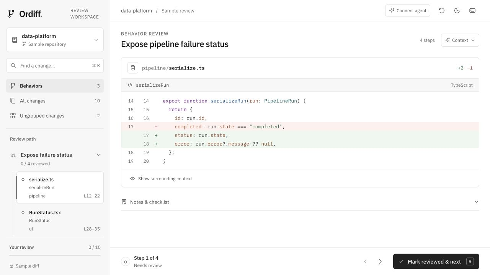
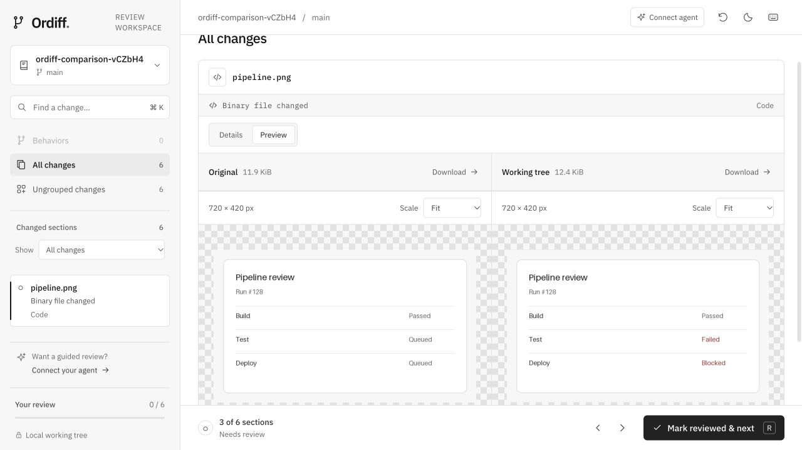

# Ordiff

Review one behavior at a time, across files.

Ordiff is a local Git review workspace. Open a checkout, inspect its working changes, and optionally connect an agent through MCP to organize the changed hunks into an ordered reading path. Review decisions stay with you.



## Run locally

Requires **Node.js 22.13 or later** and **Git**.

```sh
npm install
npm run dev
```

Open `http://127.0.0.1:5173`. The interface and local API share one Vite process. Enter a repository's absolute local path, or choose **Try the sample review** to explore the workflow without connecting a checkout.

Ordiff reads the combined changes against HEAD: staged, unstaged, and non-ignored untracked files. Repositories without commits are supported. Git access is read-only; opening a repository or recording progress does not stage, commit, discard, or edit its files.

## Review changes

1. Browse **All changes**, or connect an agent to create **Behaviors** with ordered sections. A behavior can span pipeline code, its UI consumer, tests, and documentation. Different hunks in one file remain independently reviewable.
2. Use the navigation panel to select a section. Global search finds filenames and code across the whole diff; the status filter works in both browsing and search. **Ungrouped changes** keeps sections outside the agent's plan visible.
3. Read the unified diff with language-aware syntax highlighting. **Context** opens the behavior description and the agent's explanation; it closes when you change sections. Use **Add comment** for a whole file or **Comment on section** for a specific hunk. Checklists and quick notes remain below the diff; quick notes join your feedback automatically.
4. Select **Mark reviewed & next** to record progress and find the next unreviewed section, including ungrouped changes. A reviewed section shows **Continue**; **Mark unreviewed** is a separate action.
5. Use **Build prompt** to turn your feedback into your agent's next task, during or after review. When every section is reviewed, the completion screen also offers reviewed changes, a refresh, or a new pass through the same diff. A clean repository has its own empty state and still supports general instructions.

**Undo** restores the latest mark and its previous location for six seconds. Another mark, a repository change, or a diff-version change expires it. Notes and checklist decisions are preserved by Undo.

Use **J / K** for next / previous section, **R** to mark reviewed or continue, **⌘ K / Ctrl K** to search, and **?** for help. Light and dark appearances use the same monochrome surfaces and locally bundled IBM Plex fonts. Navigation moves into a drawer below 1024px.

## Turn feedback into prompts

The **Feedback** panel holds multiple file and section comments, with **Change**, **Keep**, and **Note** labels to distinguish requests, things to preserve, and context. Text autosaves as you type. The panel sits beside the diff on wide screens and opens in a drawer below 1280px. **General instructions** holds direction for the whole task.

Choose **Build prompt** to select the files for one batch. Only files with nonempty comments appear, and each selected file includes all its comments. General instructions have their own inclusion checkbox: export file feedback, general instructions, or both. The preview updates immediately and preserves your wording and captured section references.

**Copy prompt** leaves the builder open so you can select another batch. **Download Markdown** saves the same selected prompt. If clipboard access fails, use **Select prompt text** to copy manually. No AI service or agent connection is needed to generate a prompt; direct sending to a Codex chat is not included.

Feedback survives diff refreshes, repository switches, and review-progress resets. When a referenced section changes or disappears, its comment is flagged for rechecking and retains its original reference. Explicitly reassign it to the current section or turn it into a file comment. Feedback on files no longer in the diff remains editable and exportable in the builder, with a warning in the exported prompt.

## Preview files

Changed binary files show **Original** and **Working tree** side by side. Each pane has its own controls, retry state, and download. Panes stack on narrow screens; added or deleted files show their available revision.



| Format                | Preview                                                                                             |
| --------------------- | --------------------------------------------------------------------------------------------------- |
| Images, including SVG | Browser-supported rendering, dimensions, and zoom                                                   |
| PDF                   | Page navigation, zoom, and selectable text where the document contains it                           |
| DOCX                  | Paragraphs, tables, and embedded images                                                             |
| DOC                   | Extracted text                                                                                      |
| XLSX                  | Worksheet selection and cell values                                                                 |
| CSV                   | A table alongside the unified diff                                                                  |
| Markdown              | **Diff / Preview** with tables, checklists, highlighted code blocks, and repository-relative images |
| Audio and video       | Native browser playback for supported formats and codecs                                            |

Previews run locally and support files up to **25 MiB per revision**. XLSX displays up to 20 worksheets, 200 rows, and 50 columns per sheet; CSV displays up to 200 rows and 50 columns. Markdown previews show up to 500,000 characters, and DOC text up to 200,000 characters. Unsupported, damaged, or password-protected files show a fallback. Remote Markdown images remain placeholders, and documents are not sent to an external viewer.

Use **Refresh diff** after filesystem edits. Stale previews ask for a refresh instead of showing bytes from a different diff version.

## Text diff utility

Open **Text diff utility** from the welcome screen or toolbar utility actions (inside **More actions** on compact screens). It opens a separate tab at `http://127.0.0.1:5173/tools/text-diff`; you can also open that URL directly without selecting a repository.

Paste or type into **Original** and **Modified** to see live, side-by-side differences, with changed lines and text highlighted. Both panes are editable and support undo/redo. Use **Swap**, **Clear both**, **Wrap lines**, and the previous/next change buttons to inspect the comparison. Wrapping starts enabled, and the panes stay side by side on narrow screens.

Comparison is case-sensitive and includes whitespace changes. Line endings normalize to LF. Text stays in memory in the utility's browser tab, is never sent to the local server or an external service, and clears on reload. The utility works independently of Git review, feedback, and agent connections, and uses your saved appearance preference.

## Connect an agent

Select **Connect agent** for the exact configuration for your checkout. The local stdio MCP server exposes `get_review_context` and `submit_review_plan`. Plans must reference the current diff version and existing section IDs; they cannot mark code reviewed.

See [MCP setup and tool behavior](docs/mcp.md) for configuration, limits, and the plan lifecycle.

## Local state

Repository selection and the current agent plan are saved in the app checkout's ignored `.ordiff/workspace.json`. Review progress, feedback, checklists, and appearance are saved in this browser. **Close repository** returns to onboarding and clears the server's active repository and plan; saved feedback remains available when you reopen that repository. A failed connection preserves the current workspace.

Review progress belongs to an exact repository and diff version. Refreshing changed contents starts fresh review progress while keeping feedback; refreshing an unchanged diff preserves progress. Agent plans provide a reading order, and marking a section reviewed records progress rather than certifying correctness.

## Development and checks

```sh
npm test
npm run build
npm run preview
```

`npm test` runs core and UI tests. The production build includes strict TypeScript checking. Development and production preview both use port 5173, so run one at a time.

See [the development guide](docs/development.md) for source layout, rendering packages, local interfaces, and verification.
