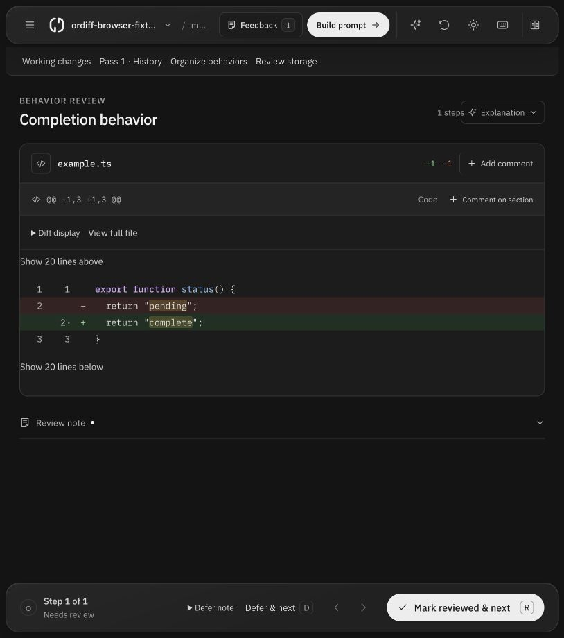

# Ordiff

Review one behavior at a time, across files.

Ordiff is a local Git review workspace. Open a checkout, inspect working changes, branch comparisons, or two commits, and optionally connect an agent through MCP to organize the changed hunks into an ordered reading path. Review decisions stay with you.


## Run locally

### macOS desktop app

On Apple Silicon with macOS 14 or later, build and install a personal desktop app:

```sh
npm install
npm run desktop:build
npm run desktop:install
```

Building requires Rust 1.95 through rustup and Apple's Command Line Tools (`xcode-select --install`). The first build downloads a checksum-verified official Node runtime and Rust dependencies. The installed app includes Node and runs without Terminal, Homebrew Node, or this checkout. Git must remain installed.

Open **Ordiff** from Spotlight or `~/Applications/Ordiff.app`. Choose **Options → Keep in Dock** from its Dock icon to pin it. Closing the last Ordiff window or choosing **Quit** stops its backend; minimizing keeps the app available to MCP while pausing UI subscriptions. Downloads save to your Downloads folder with unique filenames.

Desktop data starts fresh and persists independently of your browser. Updates are manual: quit Ordiff, rebuild, and run the installation command again. See [desktop architecture and verification](docs/desktop.md).

### Browser development

Requires **Node.js 22.13 or later** and **Git**.

```sh
npm install
npm run dev
```

Open `http://127.0.0.1:5173`. The interface and local API share one Vite process. Choose **Browse folders**, enter a repository's local path, or choose **Try the sample review** to explore the workflow without connecting a checkout. Paths beginning with `~/` are supported.

Ordiff reads the combined changes against HEAD: staged, unstaged, and non-ignored untracked files. Repositories without commits are supported. Git access is read-only; opening a repository or recording progress does not stage, commit, discard, or edit its files.

## Open and switch repositories

**Browse folders** opens the native macOS folder picker in the desktop app. In the browser, navigate local folders with breadcrumbs, **Up**, **Home**, or a folder path, then choose **Open this folder**. Enable **Show hidden folders** when needed. Selecting a subfolder opens its Git repository root; Git worktrees are supported.

The welcome screen and repository dialog show the 10 most recently opened repositories. Search by name or full path, select a row to reopen it, or use its remove button to forget the entry. Removing an entry keeps any current review open. Click the repository name in the toolbar, or **Repository settings** in the navigation panel, to switch repositories. A cancelled picker or failed connection preserves your current review.

## Review changes

1. Browse **All changes**, or connect an agent to create **Behaviors** with ordered sections. A behavior can span pipeline code, its UI consumer, tests, and documentation. Different hunks in one file remain independently reviewable.
2. Use the navigation panel to select a section. Global search finds filenames and code across the whole diff; the status filter works in both browsing and search. **Ungrouped changes** keeps sections outside the agent's plan visible.
3. Read the unified diff with language-aware syntax highlighting. **Context** opens the behavior description and the agent's explanation; it closes when you change sections. Use **Add comment** for a whole file or **Comment on section** for a specific hunk. Checklists and quick notes remain below the diff; quick notes join your feedback automatically.
4. Select **Mark reviewed & next** to record progress and find the next unreviewed section, including ungrouped changes. A reviewed section shows **Continue**; **Mark unreviewed** is a separate action.
5. Use **Build prompt** to turn your feedback into your agent's next task, during or after review. When every section is reviewed, the completion screen also offers reviewed changes, a refresh, or a new pass through the same diff. A clean repository has its own empty state and still supports general instructions.

**Undo** restores the latest mark and its previous location for six seconds. Another mark, a repository change, or a diff-version change expires it. Notes and checklist decisions are preserved by Undo.

Use **J / K** for next / previous section, **R** to mark reviewed or continue, **D** to defer, **⌘ K / Ctrl K** to search, and **?** for help. Light and dark appearances use the same monochrome surfaces and locally bundled IBM Plex fonts. Navigation moves into a drawer below 1024px.

## Turn feedback into prompts

The **Feedback** panel holds multiple file and section comments, with **Change**, **Keep**, and **Note** labels to distinguish requests, things to preserve, and context. Text autosaves as you type. The panel sits beside the diff on wide screens and opens in a drawer below 1280px. **General instructions** holds direction for the whole task.

Choose **Build prompt** to select the files for one batch. Only files with nonempty comments appear, and each selected file includes all its comments. General instructions have their own inclusion checkbox: export file feedback, general instructions, or both. The preview updates immediately and preserves your wording and captured section references.

**Copy prompt** leaves the builder open so you can select another batch. **Download Markdown** saves the same selected prompt. If clipboard access fails, use **Select prompt text** to copy manually. No AI service or agent connection is needed to generate a prompt; direct sending to a Codex chat is not included.

Feedback survives diff refreshes, repository switches, and review-progress resets. When a referenced section changes or disappears, its comment is flagged for rechecking and retains its original reference. Explicitly reassign it to the current section or turn it into a file comment. Feedback on files no longer in the diff remains editable and exportable in the builder, with a warning in the exported prompt.

## Preview files

Changed binary files show **Original** and **Working tree** side by side. Each pane has its own controls, retry state, and download. Panes stack on narrow screens; added or deleted files show their available revision.


| Format                | Preview                                                                                             |
| --------------------- | --------------------------------------------------------------------------------------------------- |
| Images, including SVG | Browser-supported rendering, dimensions, and zoom                                                   |
| PDF                   | Page navigation, zoom, and selectable text where the document contains it                           |
| DOCX                  | Paragraphs, tables, and embedded images                                                             |
| DOC                   | Extracted text                                                                                      |
| XLSX                  | Worksheet selection and cell values                                                                 |
| CSV                   | A table alongside the unified diff                                                                  |
| Markdown              | **Diff / Preview** with tables, checklists, highlighted code blocks, and repository-relative images |
| Audio and video       | Native browser playback for supported formats and codecs                                            |

Previews run locally and support files up to **25 MiB per revision**. XLSX displays up to 20 worksheets, 200 rows, and 50 columns per sheet; CSV displays up to 200 rows and 50 columns. Markdown previews show up to 500,000 characters, and DOC text up to 200,000 characters. Unsupported, damaged, or password-protected files show a fallback. Remote Markdown images remain placeholders, and documents are not sent to an external viewer.

Visible reviews detect local changes and show **Changes available — Review update**. Activating an update creates a new pass; it never happens automatically. Stale previews show an explicit unavailable state instead of substituting newer bytes.

## Text diff utility

Open **Text diff utility** from the welcome screen or toolbar utility actions (inside **More actions** on compact screens). It opens a separate tab at `http://127.0.0.1:5173/tools/text-diff`; you can also open that URL directly without selecting a repository.

Paste or type into **Original** and **Modified** to see live, side-by-side differences, with changed lines and text highlighted. Both panes are editable and support undo/redo. Use **Swap**, **Clear both**, **Wrap lines**, and the previous/next change buttons to inspect the comparison. Wrapping starts enabled, and the panes stay side by side on narrow screens.

Comparison is case-sensitive and includes whitespace changes. Line endings normalize to LF. Text stays in memory in the utility's browser tab, is never sent to the local server or an external service, and clears on reload. The utility works independently of Git review, feedback, and agent connections, and uses your saved appearance preference.

## Connect an agent

Select **Connect agent** for the exact configuration for your checkout. The local stdio MCP server captures independent agent snapshots, proposes behavior plans, reads explicitly published feedback batches, and records outcome reports. Agents cannot resolve comments or mark code reviewed.

See [MCP setup and tool behavior](docs/mcp.md) for configuration, limits, and the plan lifecycle.

## Local state

Repository selection, recent repository history, and the current agent plan are saved in the app checkout's ignored `.ordiff/workspace.json` during browser development, or `~/Library/Application Support/Ordiff/workspace.json` in the desktop app. History belongs to that local backend; desktop and browser development keep separate histories. Review progress, feedback, checklists, and appearance are saved in this browser or the desktop app's persistent WebView. **Close repository** returns to onboarding and clears the server's active repository and plan; recent history and saved feedback remain available when you reopen a repository. A failed connection preserves the current workspace.

Review progress belongs to a comparison and review pass. Activating changed contents starts a fresh pass while retaining feedback and history; unchanged refreshes preserve progress. Agent plans provide a reading order, and marking a section reviewed records progress rather than certifying correctness.

## Development and checks

```sh
npm test
npm run build
npm run preview
```

`npm test` runs core and UI tests. The production build includes strict TypeScript checking. Development and production preview both use port 5173, so run one at a time.

See [the development guide](docs/development.md) for source layout, rendering packages, local interfaces, and verification.

## Complete review cycles



The comparison toolbar selects working changes, branch changes from a merge-base, or two commits. All refs are local or already fetched. The pass selector keeps prior reviews readable; **Since previous pass** shows added, modified, unchanged, and removed sections. Every new pass requires confirmation, including **Previously reviewed · Reconfirm** sections.

Use **Defer & next** to leave a reason and put a section in **Needs another look**. Deferred sections do not count as reviewed. Search can combine file, behavior, feedback, review-state, and pass-change filters.

**Diff display** offers unified/split, wrapping, word highlighting, and display-only whitespace hiding. Expand source context by 20 lines or open a paginated full file with Before/After selection. Click a line gutter, then Shift-click to select a range and add precise feedback. Captured quotes remain available when historical source expires.

Feedback has independent intent and status. Publish an immutable MCP batch from **Build prompt**, copy its instruction, and ask your agent to report outcomes. Addressed feedback awaits human verification; only you resolve it. Later edits never alter a published batch. Review completion and unresolved feedback counts remain separate.

**Organize behaviors** supports manual groups, ordering, explanations, and overlapping membership. Incoming replacement plans require preview and acceptance. **Review storage** shows local usage and cleanup controls. Backend storage preserves real-repository comments and passes across browser or desktop restart; sample feedback stays browser-local. See [recovery and retention](docs/development.md#review-storage-and-recovery).

The sample toolbar also offers **Explore a review cycle**, an isolated walkthrough with two passes, a deferred section, addressed line feedback, and a plan proposal.
