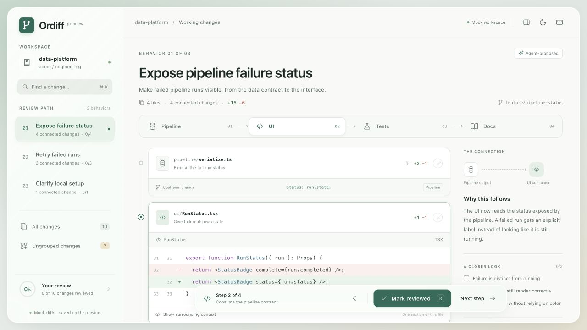
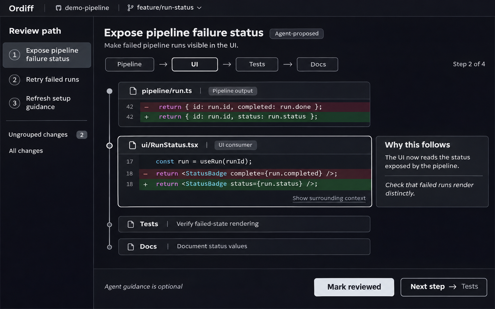

# Ordiff

Review one behavior at a time, across files.

**Working local prototype.** Ordiff reads a real Git working tree and accepts agent-proposed review paths through a local MCP server. It also includes a sample diff for exploring a behavior across pipeline, UI, tests, and docs.



*The first browser prototype. The current app uses a simpler single-diff layout with repository onboarding, optional notes, and a complete-review state. The original generated concept is preserved below.*

## Run the prototype

Requires Node.js 22.12 or later.

```sh
npm install
npm run dev
```

Open the local URL printed by Vite, normally `http://127.0.0.1:5173`. The local Git API runs in the same process. On first launch, open a repository by its absolute local path, or choose **Try the sample review**. A failed connection leaves the current repository intact.

To check the review logic and create a production build:

```sh
npm test
npm run build
npm run preview
```

### Frontend development

The interface uses **React + TypeScript on Vite**, with **Tailwind CSS** and locally owned **shadcn/ui** button, input, and textarea components. The local Git API and MCP server remain Node.js modules.

- `src/App.tsx` composes the workspace, responsive navigation, dialogs, and keyboard shortcuts.
- `src/hooks/use-review.ts` coordinates workspace requests, agent polling, browser persistence, and review actions.
- `src/review.ts` contains the framework-independent review model; `src/types.ts` defines the frontend data contracts.
- `src/components/` contains the review UI. Shared shadcn components live in `src/components/ui/` and are customized to Ordiff's existing design.
- `src/style.css` retains the original palette, typography, glass surfaces, responsive layout, and accessibility preferences. Tailwind utilities complement these styles; Preflight is intentionally omitted to preserve the design.

Run `npm run typecheck` for strict TypeScript checks, `npm run test:core` for review/Git/API/MCP tests, or `npm run test:ui` for React interaction tests. `npm test` runs both suites, and `npm run build` includes type checking. Existing browser saves keep the same storage keys, so review progress, notes, checklists, and appearance remain compatible.

### Take a walkthrough

1. In the sample review, follow **Expose failure status** through Pipeline, UI, Tests, and Docs. Each step shows one active diff and an explanation of its place in the behavior.
2. Open the optional notes and checklist, inspect context, and use **Mark reviewed & next**. Notes, checklists, progress, and appearance are saved in this browser.
3. Open **Retry failed runs** to see a separate behavior touching another section of the same UI file. Reviewing one section does not mark the other reviewed.
4. Browse **All changes** or **Ungrouped changes**, search filenames and code, and filter by review status. Ungrouped changes count toward overall progress. When every section is reviewed, a dedicated completion screen lets you browse reviewed changes, refresh the diff, or start again.
5. Open a real repository. Without an agent plan, every actual changed hunk is available in **All changes**. Click **Connect agent** to configure MCP; submitted behavior groups appear automatically. Use **Refresh diff** after editing files.

Use **J / K** for next / previous, **R** to mark reviewed and continue, and **⌘ K / Ctrl K** to search. The keyboard button opens help. Appearance switches between light and dark. Repository settings let you open another local checkout or close the repository to return to onboarding.

### Connect MCP

The working stdio server exposes `get_review_context` and `submit_review_plan`. It reads the currently selected repo, validates proposed groups against the exact current Git diff, and leaves human review decisions to the app. It cannot approve code or mark it reviewed.

Use **Connect agent** for the exact configuration for this checkout. See [MCP setup and tool behavior](docs/mcp.md) for instructions and limitations. Repo selection and plans persist locally in ignored `.ordiff/` state; review progress stays in the browser.

### Design direction

The prototype takes inspiration from Apple's [Liquid Glass material guidance](https://developer.apple.com/design/human-interface-guidelines/materials) and [Meet Liquid Glass](https://developer.apple.com/videos/play/wwdc2025/219/). Translucent navigation and a floating review dock sit above stable, readable code surfaces. This is a web interpretation using CSS materials, not Apple's native rendering system. It includes an opaque fallback, reduced-transparency and reduced-motion preferences, keyboard focus states, and a responsive navigation drawer.

## The pain

An agent changes a data pipeline. The diff also touches the UI, tests, and documentation. Another behavior is bundled into the same set of changes, sometimes in the same files.

In a file-oriented review workflow, such as the one I use in GitHub Desktop, I have to build the review path myself:

- Where should I start?
- Which UI changes belong to this pipeline change?
- Which tests check that behavior, and which docs describe it?
- Have I followed the change all the way through?

The code is available, but its relationships take work to reconstruct. Moving between files means holding unfinished explanations in my head while looking for the next relevant section. A large agent diff can make that effort exhausting before I have judged whether the changes are correct.

## The imagined product

Ordiff would organize a diff into behaviors. Each group would explain its intent and suggest a path through the actual diff sections that implement it.

A group could connect a pipeline output to its UI consumer, then to the tests and documentation. One file could appear in several groups when it contains changes for different behaviors. Navigation would work at the level of relevant diff sections, rather than requiring every file to occupy one position in a global order.

The agent would provide a proposed map. The reviewer would choose where to go and inspect the code directly.

## An example: expose pipeline failure status

Imagine an agent has made failed pipeline runs visible in the UI. Its proposed review path might be:

| Step | Change to inspect | Review question |
| --- | --- | --- |
| Pipeline | The output exposes a status instead of a completion flag. | Does the status represent the possible outcomes accurately? |
| UI | The status badge consumes that output. | Can a reviewer distinguish a failed run from a running or completed one? |
| Tests | A test covers failed-state rendering. | Would the test catch the behavior being broken? |
| Docs | The documented status values and UI behavior change. | Does the description match what the code now does? |

Each step would lead to the relevant diff, with surrounding context available. A short explanation would say why that section follows the previous one.

## The review experience

Select a behavior in the **Review path**, read its intent, and follow the connected diffs. Inspect surrounding code when needed, mark sections reviewed, and move to the next step. Jump to another group or the full diff at any time.



*Imagined UI concept generated with the built-in imagegen tool. The example code and repository are illustrative. [Complete generation prompt](docs/ui-concept-prompt.md).*

## How MCP would fit

An agent uses MCP to submit proposed behavior groups, references to diff sections, a reading sequence, and short explanations of the connections. Those suggestions are tied to the current diff; further edits invalidate the old map when refreshed.

Ordiff uses that information to present the review path alongside the code. The agent supplies review guidance, and the human retains control of navigation and judgment. The first working interface is documented in [MCP setup](docs/mcp.md).

## Keep the reviewer's view complete

**All changes** and **Ungrouped changes** would remain visible. A section outside the agent's narrative still needs attention, and a section included in it still needs scrutiny. Marking something reviewed would record progress, not certify correctness.

A coherent walkthrough can reinforce a mistaken assumption. It cannot establish that the implementation is correct or reveal every missing change. Smaller changes may still be the better answer when a behavior is too large to review comfortably.

## What needs to be proven

The hypothesis is that grouping changes by behavior reduces orientation effort and context switching while preserving careful review.

Useful evidence would include time to find a starting point, ability to explain a change across files, and issues caught during review. Feeling more comfortable or approving faster would not, by itself, establish that Ordiff improves review quality.
